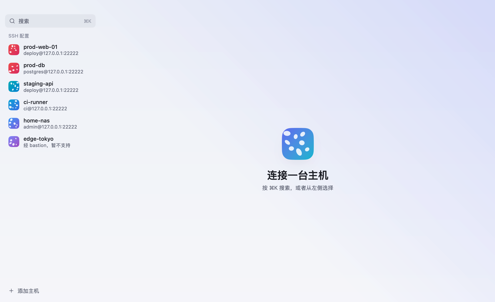

<div align="center">


# Serval

**基于 Go 与 [MyGo](https://github.com/egoist/mygo) 构建的轻量、安全、原生跨平台 SSH 与 SFTP 工作台。**

提供多标签与任意比例分屏终端、多级跳板机与 SOCKS5 / HTTP 代理、本地／远程／动态端口转发、左右双栏可拖拽 SFTP 文件抽屉、终端内 `rz` / `sz`（ZMODEM）高速传输、TOTP 自动验证码、多窗格广播输入与代码片段——全部主机、密钥与凭据均保存在端到端加密的保险库中，支持 WebDAV 与同步文件夹跨设备无感合并。

[](https://github.com/jhzhang09/serval/actions/workflows/check.yml)
[](https://github.com/jhzhang09/serval/releases)
[](go.mod)
[](LICENSE)

[](https://awesomemygo.dev/apps/serval)

**简体中文** · [English](README.en.md)

</div>



## 为什么选择 Serval

- **纯正的原生桌面界面，彻底告别 WebView。** 基于 [MyGo](https://github.com/egoist/mygo) 原生 GPU 渲染构建：纯 Go 实现，不含 Electron、WebView、Node.js，无任何外部运行时依赖。安装包仅约 5 MB，多会话常驻内存约 100 MB，空闲 CPU 接近 0%。
- **端到端加密保险库与多端无冲突同步。** 主机、私钥、密码、口令、TOTP 密钥、代理、端口转发与代码片段全部存储在 `vault.json` 中：主密码经 **Argon2id** 派生密钥，每条记录使用 **XChaCha20-Poly1305** 独立加密（磁盘文件中连主机名与 IP 地址都不以明文出现）。内置混合逻辑时钟（HLC）按记录合并算法，支持通过 **WebDAV** 或**本地同步文件夹**（iCloud Drive、Dropbox、Syncthing 等）在多台设备间安全同步。
- **冷调玻璃美学与专属主机斑纹。** 侧栏与标题栏透出系统原生毛玻璃（macOS 26 起支持 Liquid Glass），每台主机根据名称自动生成专属几何斑纹；生产环境主机自动使用红色警示边框与“生产”徽章，未激活分屏窗格覆盖柔和薄纱，一眼识别焦点位置。
- **丝滑的终端与文件协同体验。** 打开或收起侧栏、双栏文件抽屉时宽度一步到位，绝不触发连续 `SIGWINCH` 重绘风暴；双栏 SFTP 抽屉跟随终端工作目录（OSC 7），支持调整抽屉总宽度与左右分栏比例、文件与文件夹双向拖拽传输、远端文本就地编辑以及终端内原生 `rz` / `sz`（ZMODEM）收发。
- **严格的主机指纹与安全边界。** 首次连接未知主机必须人工核对指纹（加密存入保险库并随设备同步，`~/.ssh/known_hosts` 仅只读参考）；主机密钥发生变化时一律阻断连接，绝不提供带风险的“忽略并继续”。

## 功能一览

| 模块 | 核心能力 |
|---|---|
| **加密保险库与同步** | Argon2id + XChaCha20-Poly1305 逐条记录加密；首次保存秘密时引导设置主密码；设置“安全”分页集中管理闲置自动锁定、本机安全存储自动解锁、修改主密码与已知主机；所有密码与密钥输入框支持明文显隐切换（关闭或锁定时自动清零）；支持 WebDAV 与 S3 兼容对象存储云同步（切换分页或关闭时自动保存草稿，一键“立即同步”双向按记录合并）、同步文件夹与字段级冲突解决。 |
| **主机与分组管理** | 左侧栏支持拖动调整宽度并持久化；支持添加、编辑、复制、删除主机，以及可持久保存的空自定义分组与组内拖至末尾排序；支持多标签（`#tag`）横向滚动筛选与搜索快速清空；主机表单支持粘贴 `user@host[:port]` 自动拆分与可折叠高级选项；异步探测主机连通性与往返延迟（RTT）；右键直达分屏打开、仅打开 SFTP 与复制 SSH 命令；每台主机可标记“生产环境”（红框警示与广播二次确认）；命令面板（`⌘K`）支持快速临时连接与直达已知主机管理。 |
| **认证、MFA 与密钥** | 支持“自动”（依次尝试私钥、`ssh-agent`、密码）、“仅密码”、“仅私钥”三种策略；内置密钥管理器支持导入或生成 **Ed25519** / **RSA 4096** 私钥、在主机表单内直接导入，并一键将公钥幂等部署到服务器（`~/.ssh/authorized_keys`）；支持 `keyboard-interactive` 多步验证（PAM / OTP）与 **RFC 6238 TOTP**（`otpauth://` 或 Base32）自动填写验证码；支持按主机开启 `ssh-agent` 转发与登录后自动执行脚本。 |
| **多级跳板机与代理** | 可视化串联最多 **8 级跳板机**（含地址展示与链路预览，自动展开并检测环路），逐跳独立核对指纹与询问密码；内置 **SOCKS5** 与 **HTTP** 代理管理（支持加密保存代理密码），多台主机一键复用。 |
| **端口转发** | 统一管理**本地转发（Local）**、**远程转发（Remote）**与**动态转发（SOCKS5）**；列表支持紧凑启停与删除，编辑表单使用下拉框绑定主机（连接后自动开启、断开后自动关闭），亦可手动启停并实时查看监听地址与双向流量统计。 |
| **多标签与分屏终端** | 支持远程 SSH、Telnet、串口与**本机终端（Local Shell）**混排；标签栏支持横向滚动、`+` 键快速新建本机终端与无遮挡连接状态胶囊指示，支持拖拽与快捷键排序；水平／垂直任意比例拆分窗格、终端内查找（`⌘F`）、断线指数退避自动重连、启动时按原窗格布局恢复上次会话；支持字号、行高、光标样式、选中自动复制、右键行为、回滚缓冲区（MB）与多套深浅色终端主题即时切换。 |
| **广播输入与代码片段** | **广播输入**开启时自动展示顶部控制条，可直接点击窗格编号芯片（`#1..N`）或“全选当前窗格”控制同步范围（生产环境窗格加入前强制二次确认）；**代码片段**支持从侧栏快捷入口直接打开，列表行提供一键直接执行与“更多”菜单，并支持 `{{变量名}}` 模板占位符与多行确认。 |
| **双栏 SFTP 文件抽屉** | `⌘J` 呼出左右双栏（窄窗口下与 AI 抽屉自动互斥），顶部带关闭按钮并支持点击输入路径与远程目录书签，支持拖动调整抽屉总宽度与内部分栏比例；支持文件与递归文件夹双向拖拽、本机栏右键新建文件夹／重命名／上传／删除空目录、传输队列失败重试／单项移除／一键清理已完成项，以及随窗口自适应且带 `⌘S`/`Ctrl+S` 保存提示与外部修改冲突检测的**远端 UTF-8 文本在线编辑**。 |
| **ZMODEM（`rz` / `sz`）与日志** | 纯 Go 自研 ZMODEM 协议栈，在远程终端直接运行 `rz` 或 `sz` 即可弹出原生文件／目录选择框高速传输，带实时进度条与取消支持；可选开启远程会话纯文本日志记录。 |
| **AI Agent 助手** | `⌘I` 呼出右侧停靠式 AI Agent（支持 DeepSeek、OpenAI、通义千问、Kimi、Ollama 及自定义 OpenAI 兼容接口多配置快速切换），终端窗格栏支持一键分析报错（`⌘E`）；支持流式输出、思考过程折叠、只读探查／远端命令执行（`ssh_exec`）／SFTP 目录读取工具调用、三级权限模式（自动执行 / 确认执行 / 只读观察，高危命令强制拦截）、原生 Markdown 表格渲染与 `@` 上下文 / `/` 斜杠命令。 |

## 安装指南

### Homebrew 安装（推荐）

```bash
# 桌面应用（macOS 13+）—— 安装 Serval.app、配置 `serval` 命令并自动移除隔离属性
brew install --cask jhzhang09/tap/serval
```

### 手动下载安装包

前往 [**GitHub Releases**](https://github.com/jhzhang09/serval/releases) 页面下载对应平台的最新版本：

| 平台 | 安装包 |
|---|---|
| macOS 13+（Apple Silicon 与 Intel 通用） | `serval-<version>.dmg` |
| Windows 10 1809+ / Windows 11 | `serval-setup-<version>-<arch>.exe`（安装版）或 `serval-<version>-windows-<arch>-portable.zip`（免安装版） |
| Linux（glibc 2.28+，GTK 3） | `serval_<version>_<arch>.deb` 或 `serval-<version>-linux-<arch>.tar.gz` |

所有发布版本均附带 `SHA256SUMS.txt` 与 [GitHub 构建来源证明（Build Provenance Attestation）](https://docs.github.com/actions/security-for-github-actions/using-artifact-attestations)，可通过以下命令校验真实性：

```bash
gh attestation verify <文件名> --repo jhzhang09/serval
```

<a id="macos-gatekeeper"></a>
<details>
<summary><b>手动下载 <code>.dmg</code> 后 macOS 提示“无法打开 Serval”</b></summary>

发布构建使用临时签名（通过 Homebrew Cask 安装时会自动移除隔离属性）。若从浏览器手动下载 `.dmg` 安装，只需在终端执行一次以下命令即可正常打开：

```bash
xattr -dr com.apple.quarantine /Applications/Serval.app
```

或者先尝试打开一次，随后前往 **系统设置 → 隐私与安全性** 点击 **仍要打开**。
</details>

<details>
<summary><b>Windows 出现 SmartScreen 警告</b></summary>

点击 **更多信息 → 仍要运行** 即可。
</details>

<details>
<summary><b>Linux 安装与运行</b></summary>

```bash
sudo apt install ./serval_<version>_amd64.deb
# 或直接解压运行（也可执行包内的 install.sh 安装到 ~/.local）：
tar xzf serval-<version>-linux-amd64.tar.gz && ./serval
```
</details>

### 从源码构建

需要 Go 1.27.3+，以及 macOS 13+、Windows 10 1809+ 或 glibc 2.28+ 的 Linux。

```bash
git clone https://github.com/jhzhang09/serval.git
cd serval
go tool mygo dev      # 开发模式运行
go test ./...         # 运行全部测试
go tool mygo build    # 打包当前平台原生安装包到 build/（macOS 生成 Serval.app 与 .dmg）
go run ./cmd/genicon  # 重新生成应用图标
```

## 快捷键与外观

点击侧栏底部「**设置**」、按 `⌘,`（Windows / Linux 为 `Ctrl+Shift+,`），或通过命令面板（`⌘K`）可在**通用、安全、终端、同步、AI**五个分页中配置外观模式、自动锁定与已知主机、终端字号行高与配色方案、云同步以及 AI 服务商参数。

macOS 使用 `⌘`；Windows 与 Linux 使用 `Ctrl+Shift`，避免与终端内常用的 `Ctrl+D`、`Ctrl+W`、`Ctrl+K` 冲突：

| 操作 | macOS 快捷键 | Windows / Linux 快捷键 |
|---|---|---|
| 打开设置 | `⌘,` | `Ctrl+Shift+,` |
| 命令面板：搜索主机、快速连接与全部操作 | `⌘K` | `Ctrl+Shift+K` |
| 在当前终端窗格中查找 | `⌘F` | `Ctrl+Shift+F` |
| 向右拆分终端窗格 | `⌘D` | `Ctrl+Shift+D` |
| 向下拆分终端窗格 | `⌘⌥D` | `Ctrl+Shift+Alt+D` |
| 关闭当前终端窗格 | `⌘W` | `Ctrl+Shift+W` |
| 切换上一／下一标签页 | `⌘[` / `⌘]` | `Ctrl+Shift+[` / `]` |
| 左移／右移当前标签页顺序 | `⌘⌥[` / `⌘⌥]` | `Ctrl+Shift+Alt+[` / `]` |
| 显示或收起双栏 SFTP 文件抽屉 | `⌘J` | `Ctrl+Shift+J` |
| 显示或收起 AI Agent 侧边抽屉 | `⌘I` | `Ctrl+Shift+I` |
| AI 分析当前窗格终端报错 | `⌘E` | `Ctrl+Shift+E` |
| 显示或收起左侧主机栏 | `⌘\` | `Ctrl+Shift+\` |
| 保存远端在线编辑的文本 | `⌘S` | `Ctrl+S` |

## 功能详解

### 数据存储与多端同步

主机、私钥、密码全部存在 Serval 自己的加密保险库 `vault.json` 里（在配置目录下），各平台格式相同。详细加密格式与演进规则见 [docs/storage.md](docs/storage.md)。

- **加密：** 主密码经 Argon2id 派生密钥，包裹一把随机的保险库密钥；每条记录用 XChaCha20-Poly1305 单独加密。文件里只有记录 ID、类型和版本号是明文，看不到主机名、地址、密码和私钥。
- **主密码：** 第一次保存秘密（添加私钥、在主机里填密码、连接时勾选“记住密码”）时设置。主密码无法找回。
- **在这台设备上记住：** 默认勾选，把保险库密钥存进系统安全存储（macOS 钥匙串、Windows 凭据管理器、Linux Secret Service），打开时自动解锁。数据本身不在那里，那把钥匙也不同步。不勾选时，每次打开先输入主密码。
- **多端同步：** 每条记录带混合逻辑时钟版本号，删除留墓碑（90 天后清理），按记录合并；不同版本的 Serval 互相编辑记录时不会丢掉对方的新字段。已核对过的主机指纹也存在保险库里，随数据同步。支持配置 **WebDAV**（坚果云、Nextcloud、群晖 NAS 等）、**S3 兼容对象存储**（AWS S3、Cloudflare R2、MinIO、阿里云 OSS、腾讯云 COS 等）或选择**本地同步文件夹**（配合 iCloud Drive、OneDrive、Syncthing 等使用）。开启后修改自动同步，冲突时由 ETag 乐观锁保障安全合并。
- Serval 不读取 `~/.ssh/config`，也不从其他工具导入。`~/.ssh/known_hosts` 仍然只读地参与主机密钥校验。

### 密钥管理

侧栏底部的“密钥”（或命令面板）管理私钥：

- **添加：** 选择私钥文件（默认打开 `~/.ssh`），或者粘贴私钥内容。加了口令的私钥要输入口令才能导入，可以选择保存口令。私钥内容存进保险库，原文件删掉、移动都不影响使用。
- **生成：** Ed25519（推荐）或 RSA 4096，可选再加一道口令。生成后直接显示公钥，一键复制，加到服务器的 `~/.ssh/authorized_keys` 即可。
- **使用：** 添加或编辑主机时选“私钥”认证，从下拉框选一把；只有一把私钥时自动选上。口令没保存的私钥会在连接时询问，可以勾选记住。
- **删除：** 先确认；正在使用它的主机改回“自动”认证。

### 主机、跳板机、代理与端口转发

- **添加、编辑、复制、删除：** 右键主机，或者点行尾的“⋯”。删除前会确认，并列出经它跳转的主机。主机名称必须唯一，因为跳板机按名称查找主机；修改主机名称时会自动同步更新引用它的跳板机设置。
- **跳板机：** 在主机表单中默认收起，点“添加跳板机”后直接按顺序选择已保存的主机（支持组合多级跳板，最多 8 级，自动检测环路）。每台机器的指纹分别确认；哪一台需要密码，就只为那一台询问，面板会注明“这是连接某某途中的跳板机”。
- **代理：** 侧栏底部或命令面板在“代理”里统一管理。支持 SOCKS5 和 HTTP 代理，支持配置代理密码（密码加密保存在保险库中）；在主机表单中按需勾选选择，多台主机一键复用，只用于第一跳。目标主机没设代理时，沿用第一台跳板机的代理。
- **端口转发：** 侧栏或命令面板里添加本地转发、远程转发和动态转发（SOCKS5）。规则存在保险库里。可以绑定某台主机，连上后自动开启，会话都断开后关闭；列表里也能手动启动和停止，并看到监听地址和流量。监听地址留空时只使用 `127.0.0.1`。

### 终端、双栏 SFTP 与 ZMODEM

- **双栏文件抽屉（SFTP）：** `⌘J` 打开文件抽屉，左右两栏并排：左边是本机目录（从主目录开始），右边跟随终端当前目录，顶部清晰展示两侧目录路径。可自由拖动抽屉左缘调整抽屉总宽度，或拖动中间分隔线调整本地与远程栏比例（双击恢复默认宽度与 50% 平分）。把文件或文件夹从一栏拖到另一栏即可上传或下载；传到服务器上已有同名文件时先确认，下到本机时已有同名位置则不覆盖。工具栏支持选择整个文件夹上传，右键目录可下载成文件夹（不跟随符号链接）。支持新建文件夹、重命名、修改权限、删除（先确认）、复制路径与远端 UTF-8 文本在线编辑（保存前自动检测远端文件是否被外部修改）。
- **拖到终端上传：** 把文件或文件夹从访达拖到远程终端上，用 SFTP 传到终端的当前目录（需要服务器的 shell 用 OSC 7 上报目录，没有上报时传到主目录并提示）。
- **rz / sz：** 在远程终端里运行 `rz`，弹出文件选择框（可多选）上传到 shell 当前目录；运行 `sz 文件…`，选择保存的文件夹（每次传输只问一次），同名文件不覆盖、自动编号。窗格内实时显示传输进度与速率，支持随时取消。

## 验证结果（Apple M2 Max，MyGo v0.8.1）

| 项目 | 结果 |
|---|---|
| 打包体积 | `Serval.app` 18.0 MB，安装镜像 `.dmg` 5.7 MB |
| 2 个会话、3 个终端 | 物理内存约 116 MB；空闲 CPU 约 0.1%（会话稳定后），无会话 0.15% |
| 10 个会话（空闲） | 物理内存约 100 MB，CPU 约 0% |
| 100 万行、约 66 MB 输出 | 1.62 秒（本机回环吞吐测量） |
| 反复开关会话 6 轮 | 内存平稳不持续增长，TCP 连接全部释放 |
| 终端渲染 | 24 位真彩色、中文宽字符、`vim` 分屏、`top` 全屏正常 |
| 私钥与保险库安全 | 带口令私钥导入、主密码派生、XChaCha20-Poly1305 加密落盘；`vault.json` 中无任何明文主机名、地址、密码或私钥 |
| 跳板机、代理与转发 | 多跳指纹与密码逐跳验证、SOCKS5 / HTTP 代理、本地／远程／动态端口转发往返验证通过 |

## 项目文档与目录结构

| 文档 / 路径 | 说明 |
|---|---|
| [AGENTS.md](AGENTS.md) | 开发约定、常用命令、硬性约束与测试要求 |
| [docs/architecture.md](docs/architecture.md) | 架构分层、线程模型、数据流与扩展点 |
| [docs/storage.md](docs/storage.md) | 加密保险库格式、混合逻辑时钟与多端合并规范 |
| [docs/roadmap.md](docs/roadmap.md) | 功能演进路线图与验收标准 |
| [docs/releasing.md](docs/releasing.md) | GitHub Actions 自动发版与 Homebrew Cask 更新流程 |
| [docs/review-checklist.md](docs/review-checklist.md) | 交付自查与代码审查清单 |
| `core/sshconn` | SSH 连接、跳板机、代理、主机密钥校验、终端、SFTP（不依赖 UI） |
| `core/vault` | 加密保险库、Argon2id 派生、混合逻辑时钟、按记录合并（不依赖 UI） |
| `core/syncer` | WebDAV 与同步文件夹传输层（不依赖 UI） |
| `core/keys` | 私钥解析、生成与指纹计算（不依赖 UI） |
| `core/hosts` | 主机、代理、转发模型与跳板机链路解析（不依赖 UI） |
| `core/totp` | RFC 6238 TOTP 动态验证码（不依赖 UI） |
| `core/zmodem` | 纯 Go ZMODEM 协议实现（`rz` / `sz`，不依赖 UI） |
| `core/ai` | OpenAI SSE 流式客户端、Agent 工具循环与 Markdown 解析（不依赖 UI） |
| `design/` | 视觉规范：配色、字体、Lucide 图标、动效与主机斑纹生成 |

## 参与贡献

欢迎提交 Issue、功能建议与 Pull Request！在提交代码前请先阅读 [AGENTS.md](AGENTS.md) 与 [docs/review-checklist.md](docs/review-checklist.md)，并确保本地通过全部静态检查与测试：

```bash
go vet ./... && gofmt -l .                      # gofmt 应当无任何输出
go tool mygo vet .
go test -race -count=1 -timeout 20m ./...       # 完整竞态与界面回归测试
```

## 致谢

衷心感谢以下开源项目及其作者：

- **[MyGo](https://github.com/egoist/mygo)**（作者 [@egoist](https://github.com/egoist)）—— 纯 Go 原生桌面 UI 框架，为 Serval 提供了跨 macOS、Windows 与 Linux 的 GPU 渲染窗口、虚拟化列表、终端插件与毛玻璃视觉效果。
- **[Netcatty](https://github.com/binaricat/Netcatty)** 与 **[Kero](https://github.com/egoist/kero)** —— 提供了产品交互与冷调玻璃视觉设计的灵感参考（Serval 完全独立实现，未复用任何 GPL 代码）。
- **[golang.org/x/crypto](https://pkg.go.dev/golang.org/x/crypto)** 与 **[pkg/sftp](https://github.com/pkg/sftp)** —— 提供 SSH、Argon2id、XChaCha20-Poly1305 与 SFTP 协议基础能力。
- **[JetBrains Mono](https://www.jetbrains.com/lp/mono/)**（SIL OFL 1.1）与 **[Lucide Icons](https://lucide.dev/)**（ISC）。

## 作者与许可证

由 **[jhzhang09](https://github.com/jhzhang09)** 开发与维护（[github.com/jhzhang09/serval](https://github.com/jhzhang09/serval)）。

本项目基于 [MIT 许可证](LICENSE) 开源。
