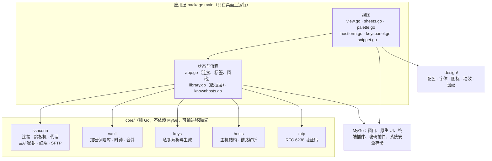
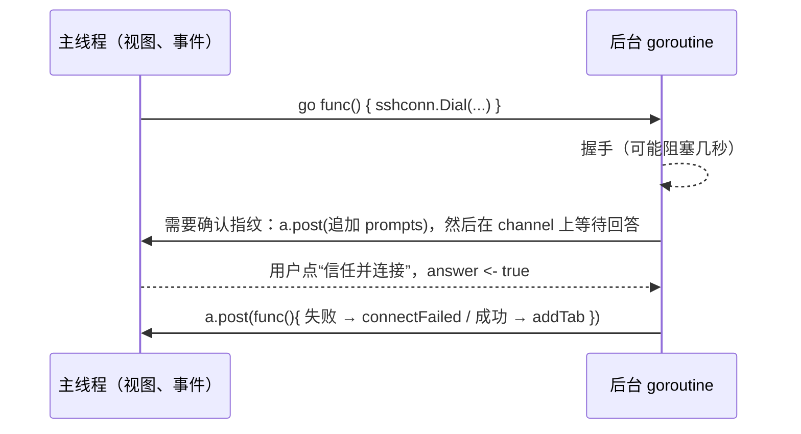

# 架构

本文描述 Serval 现在的代码结构（对应提交 `b22fb39` 之后的 main）。加功能前先找到它属于哪一层、走哪条数据流，再看“扩展点”一节有没有现成的做法。

## 总览



依赖只能从上往下：core 包不能引用应用层、`design` 或 MyGo。目前这些 core 包互不引用，需要互相引用时只能单向，不能成环。

## 分层职责

### core/sshconn

| 文件 | 职责 | 关键类型 |
|---|---|---|
| `client.go` | 建立连接：逐跳握手、认证方式组装、超时、保活、ssh-agent 转发 | `Config`、`Client`、`HopError`、哨兵错误 `ErrAuthFailed` 等 |
| `proxy.go` | SOCKS5、HTTP CONNECT 代理，只用于第一跳 | `Proxy`、`ParseProxy` |
| `hostkey.go` | 主机密钥校验：只读的 `~/.ssh/known_hosts` 加应用提供的信任存储 | `HostKeyPolicy`、`TrustedKeys`、`HostKeyChangedError` |
| `shell.go` | 带 PTY 的交互 shell，实现 `io.ReadWriteCloser` 交给终端插件 | `Shell` |
| `sftp.go` | 目录列表 | `Files`、`Entry` |

连接链路：`Config.Jumps` 依次是跳板机，最后连目标。第一跳可以走代理，后面每跳经上一跳的 `direct-tcpip` 通道。每跳独立认证、独立校验主机密钥。跳板机出错包成 `HopError{Hop: i}`，目标主机的错误原样返回，界面据此判断该向哪台机器要密码。通道连接不支持 `SetDeadline`，握手超时用 `time.AfterFunc` 实现。

### core/vault

见 [storage.md](storage.md)。要点：

- 一个文件 `vault.json`，记录逐条用 XChaCha20-Poly1305 加密，保险库密钥（VK）由主密码经 Argon2id 包裹。
- 三种状态：`Unprotected`（没设主密码，记录明文，只允许没有秘密的数据）、`Locked`、`Unlocked`。
- `Apply` 原子写入一组修改，写盘失败时内存回滚；`JSONChange` 写入时保留不认识的字段。
- 版本号是混合逻辑时钟；删除留墓碑，90 天后清理并推进水位；`Merge` 按记录合并另一台设备的文件。
- 所有方法并发安全（内部一把锁）。

### core/totp

`totp.Parse` 接受 `otpauth://totp/` 链接或 Base32 密钥，`totp.Code` 按 RFC 6238 计算当前验证码。不支持 HOTP。应用层在多步验证的问题像验证码时调用它，算不出来才询问用户。

### core/keys、core/hosts

- `keys.Key`：名称、类型、PEM 私钥、公钥、指纹、可选口令。`Parse` 导入时就校验口令；`Generate` 生成 Ed25519 或 RSA 4096。
- `hosts.Host`：主机记录（包括密码）。`ResolveRoute` 把 `ProxyJump` 展开成跳板机链路，处理名称引用、`[user@]host[:port]` 写法、环路和级数上限。

### 应用层（package main）

| 文件 | 职责 |
|---|---|
| `main.go` | 启动：配置目录、设备 ID、打开保险库、自动解锁、加载本机设置、创建窗口、接上 `a.post` |
| `app.go` | `app` 状态结构；连接流程（`connect`、`connectFailed`、`askSecret`、`submitSecret`、`rememberCredentials`）；标签和窗格树（拆分、关闭、重连）；保活；文件抽屉 |
| `library.go` | 保险库与界面之间的数据层：`reload`、`apply`、`hostChange`/`keyChange`/`settingsChange`；本机设置（`device.json`）读写；设置主密码（`requireProtection`、`submitSetup`）；解锁和“在这台设备上记住” |
| `knownhosts.go` | 用保险库实现 `sshconn.TrustedKeys`；已知主机列表、指纹摘要与重置/删除主机密钥 |
| `hostform.go` | 主机表单（添加、编辑、复制）、删除确认、主机菜单 |
| `hostroute.go` | 主机表单中的跳板机选择链与代理按需展开/选择控件 |
| `proxypanel.go` | 代理独立管理面板（列表、添加、编辑、删除、密码管理） |
| `keyspanel.go` | 密钥面板（列表、导入、生成、详情、删除） |
| `settings.go` | 设置结构（随同步 `settings` 与本机 `deviceSettings`）、设置面板（外观切换、已知主机管理等）、本机最近使用主机记录 |
| `sessionlog.go` | 远程终端输出的纯文本会话日志；开关和目录在本机 `device.json`，默认关闭 |
| `view.go` | 根视图、侧栏、主机行、标签栏、窗格卡片、文件抽屉、快捷键 |
| `sheets.go` | 玻璃浮层 `sheet`、主机指纹确认、密码询问、设置主密码、锁定页面 |
| `palette.go` | 命令面板（⌘K）和模糊匹配 |
| `snippet.go` | 代码片段：变量替换、管理面板、发送到当前窗格 |
| `broadcast.go` | 广播输入：选择窗格、生产环境确认、把当前窗格的键盘输入镜像到其他窗格 |
| `paths.go` | `~/` 展开 |
| `e2e.go` | 只在 `-tags e2e` 构建里引入自动化插件 |

### design/

`tokens.go`（`design.Of(dark)` 返回整套颜色，`Theme`、`Terminal` 主题，字体，图标加载）、`motion.go`（`Hover`、`Glide`、`Pop`、`SlideIn`、`Arrival`、`Breathe` 等动效参数）、`coat.go`（由主机 ID 生成的斑纹图案，生产环境固定红色）。`tokens_test.go` 用测试保证文字对比度和终端 16 色达到 WCAG AA。

## 线程模型

MyGo 的视图函数和事件回调都在主线程上运行。规则只有一条：**`app` 的字段只在主线程读写**。



- `a.post` 在正式运行时是 `win.Update`，在测试里是一个队列，由 `harness.pump` 在测试线程执行。
- 后台 goroutine 可以直接调用并发安全的对象（`vault.Vault`、`sshconn.Client`），但不能碰 `a.hosts`、`a.tabs` 这类界面状态。`vaultTrust` 就是这样：它在连接 goroutine 里读写保险库，不碰界面。
- 需要阻塞的系统调用（文件选择框 `mygo.Dialog.Open`）也放在后台，结果用 `a.post` 送回来（见 `pickKeyFile`）。
- 取消：每个连接有一个 `context`。`cancel` 只能在回到主线程之后调用，否则 `connectFailed` 会把真正的失败误判成用户取消。

## 关键数据流

### 启动

`main` → `vault.DeviceID` → `vault.Open`（打不开就退出，绝不新建空保险库覆盖它）→ `a.device = mygo.Secrets` → `unlockWithRemembered()`（本机记住了 VK 就自动解锁）→ `reload()` → 创建窗口。保险库仍是 `Locked` 时，`view()` 只渲染锁定页面。

### 连接一台主机

1. `open(h)`：已有标签就切过去，否则 `connect(h, nil)`。
2. `connect`：按 ID 从保险库取最新的主机（调用方手里可能是旧副本）→ `ResolveRoute` 得到跳板机链路 → 解析代理 → 为链路上每台机器生成 `sshconn.Config`：认证方式决定用哪些方法（`hopConfig`），没输入的密码和口令从保险库补上（`fillSaved`）。
3. 后台 `Dial` 加 `OpenShell`。
4. 失败：`connectFailed` 判断出错的是哪一跳，按错误类型给出提示，或者为那一跳弹出密码、口令询问（`askSecret`）。之前几跳输入过的内容带着，重试时不用再输。
5. 成功：`rememberCredentials` 把勾选了“记住”的密码存到主机上、口令存到私钥上（只在连接成功后保存，输错的不会留下）→ `addTab` 创建标签和第一个窗格。

### 保存秘密

任何会保存密码、私钥、口令的入口（主机表单、密钥面板、密码询问里的“记住”）都先调用 `requireProtection(then)`：

- 保险库已加密：直接执行 `then`。
- 未加密：打开“设置主密码”面板，原来的面板让位但内容保留；设置成功后执行 `then`，取消则什么都不做。

### 写数据

界面状态不直接修改 `a.hosts`、`a.keys`。所有修改走 `a.apply(changes...)`：写入保险库 → `reload()` 重新读出 → 更新标签里的主机副本。写盘失败时列表保持原样，错误显示给用户。

## 界面结构

```
view()
├── backdrop                       窗口底色渐变
├── lockScreen                     保险库锁定时只渲染它
└── Row
    ├── sidebar                    过滤主机、可折叠分组、添加主机、密钥
    └── Column
        ├── tabBar                 标签放在标题栏里
        └── workspace              窗格卡片树（paneView）+ 文件抽屉，没有标签时是 emptyState
浮层（按渲染顺序，后面的盖在上面）：
hostKeyDialog → authDialog → hostDialog → keysDialog → snippetsDialog → settingsDialog → setupDialog → deleteDialog → toasts → paletteDialog
```

- 浮层的状态都在 `app` 上（`a.form`、`a.keyPanel`、`a.auth`、`a.setup` …），`open` 为假时渲染函数直接返回。
- `fresh` 标记让浮层在打开的第一帧从 `Pop` 姿态弹出。
- 关闭浮层时清空它的状态，不把输入过的密码留在内存里。

## 测试架构

| 层次 | 做法 | 例子 |
|---|---|---|
| core 单元测试 | 直接调用，连接测试起真实的 `devsshd` 和 `devproxy` | `core/sshconn/route_test.go`、`core/vault/sync_test.go` |
| 界面流程测试 | `ui.NewTester` 无窗口渲染，`harness` 提供真实 SSH 服务器、临时保险库、内存版系统安全存储，`pump` 执行后台结果 | `main_test.go`、`hostform_test.go`、`keyspanel_test.go` |
| 真机验收 | e2e 构建开启自动化 socket，Python 驱动按 Key 或文字操作、截图 | `tools/e2e/` |

## 扩展点

**新增一种保险库记录**（例如代码片段）：定义结构体（带 `json` 标签）→ 在 `library.go` 加 `kind` 常量和 `xxxChange`（用 `mustJSONChange`）→ `reload` 里 `decodeAll` 到 `a.xxx` → 如果含秘密，保存前 `requireProtection` → 在 [storage.md](storage.md) 的记录类型表里登记。不用改 `core/vault`。

**新增一个浮层面板**：状态结构放 `app` 上（含 `open`、`fresh`）→ 渲染函数开头判断 `!open || a.setup.open` → 用 `sheet(...)` → 在 `view()` 的浮层列表里按层级插入 → 关闭时清空状态。

**新增一种连接行为**（认证方式、协议选项）：能力放 `core/sshconn` 的 `Config` 里并写单元测试；应用层只负责从主机记录映射到 `Config`（`hopConfig`）和处理新的错误类型（`connectFailed`）。

**新增设置项**：跨设备一致的偏好加进 `settings.go` 的 `settings` 结构体，通过 `a.saveSettings` 写进保险库（固定 ID `settings`）；只属于当前设备的配置加进 `deviceSettings` 结构体，通过 `a.saveLocal` 写入配置目录下的 `device.json`。

## 依赖

| 依赖 | 用途 | 协议 |
|---|---|---|
| `github.com/egoist/mygo` v0.8.1 | 原生 UI、窗口、终端插件（libghostty-vt）、玻璃插件、系统安全存储、自动化插件 | MIT |
| `golang.org/x/crypto` | SSH、Argon2id、XChaCha20-Poly1305、knownhosts、agent | BSD-3 |
| `golang.org/x/net/proxy` | SOCKS5 | BSD-3 |
| `github.com/pkg/sftp` | SFTP 客户端，以及测试服务器的 SFTP 子系统 | BSD-2 |
| `github.com/creack/pty` | 只给开发服务器用（真实 shell） | MIT |

MyGo v0.8.1 支持 macOS、Windows、Linux 和浏览器，不支持 iOS 和安卓；移动端要另做界面，复用 `core/`。
